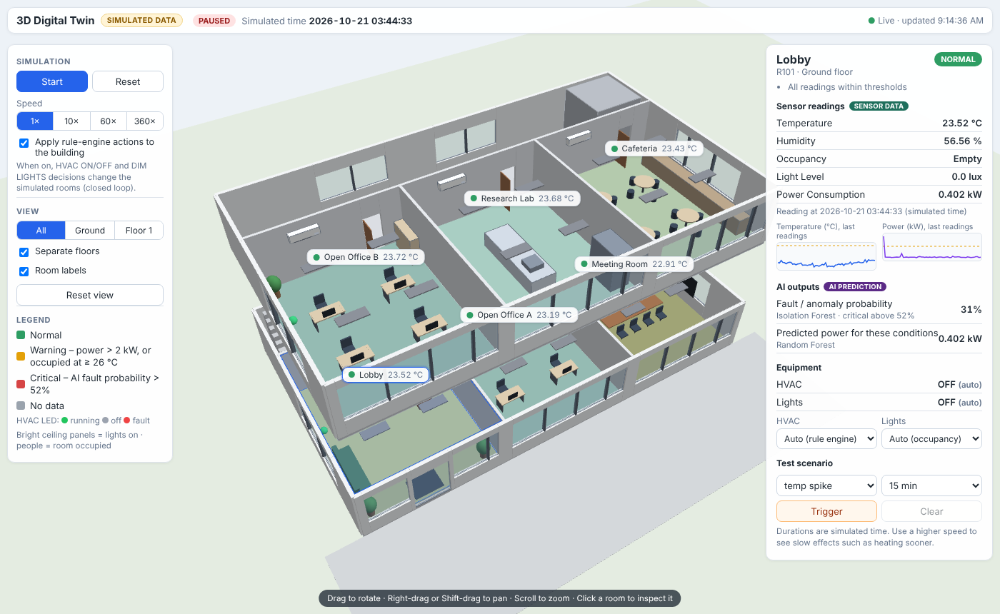

# AI-Powered Digital Twin for Smart Building — Simulation Build with 3D Twin

BCSE497J — Project 1. A fully simulated version of the architecture in the project
proposal: no physical hardware, ESP32, or real cloud IoT platform is used.

This version adds an **interactive 3D digital twin**. A simulated building with six
rooms on two floors is now the source of every sensor reading. The rooms' state
(occupancy, temperature, humidity, HVAC, lights, faults) evolves over simulated
time; the backend measures one reading per room from that state, stores it,
runs it through the existing AI models and rule engine, and both the existing
Streamlit dashboard and the new 3D view display the stored results.

> All readings are **simulated**. They are not measurements from a real building,
> and the simulation is a simple rule-based model, not a validated building-physics model.



---

## What is in the project

| # | Module | Maps to architecture diagram | File(s) |
|---|--------|-------------------------------|---------|
| 1 | IoT + Data Simulation Layer — **now a simulated building with rooms** | Layers 1–2 (Physical + IoT Edge) | `backend/building.py`, `backend/simulation.py`, `backend/simulator.py`, `backend/database.py` |
| 2 | Digital Twin Dashboard + **3D Digital Twin** | Layers 5–6 (Digital Twin + Application) | `dashboard/app.py`, `frontend/twin/` |
| 3 | AI & Analytics Engine | Layer 4 (AI & Analytics) | `backend/train_models.py`, `backend/main.py` |
| 4 | Optimization & Feedback Engine — **now applied back to the simulated rooms** | Layer 7 (Feedback & Control) | `backend/rule_engine.py` |

### Sensor types (unchanged)

The dashboard showed exactly five sensor values before this change; the simulation
produces exactly these five, per room, with the same names, units and labels. No
sensor types were added.

| Field (DB / API) | Dashboard label | Unit | How it is simulated |
|---|---|---|---|
| `temperature` | Temperature | °C | First-order relaxation towards an equilibrium set by the outdoor daily curve (27 ± 5 °C, as in the original simulator), the room's offset and internal gains (+1.5 °C occupied, +0.3 °C lights on); the HVAC, when running, pulls the room towards 23 °C (time constant 20 min). Sensor noise σ = 0.15 °C. |
| `humidity` | Humidity | % | Relaxes (45 min) towards the original daily curve 55 ± 10 %, +3 % when occupied, −6 % while the HVAC is cooling, plus a room offset. Noise σ = 1 %. Clamped to 20–90 %. |
| `occupancy` | Occupancy | Empty / Occupied (0/1) | Two-state Markov process per room. Its long-run probability follows the room's daily profile (office: 0.85 in working hours, 0.35 around them, 0.05 at night — the original values; lobby, meeting room, lab and cafeteria have their own profiles). Mean switching time ~15 min, so occupancy persists instead of being re-drawn on every reading. |
| `light_level` | Light Level | lux | Daylight curve of the original simulator (peak 800 at noon) × the room's glazing factor, + artificial light 300 (on) / 150 (dimmed) / 0 (off), + noise σ = 15. |
| `power_consumption` | Power Consumption | kW | Room base load (0.35–0.45) + 0.4 occupant devices + 0.1 / 0.05 lighting + 0.8 HVAC when running (the original simulator's loads) + fault load, + noise σ = 0.04. |

Each reading also carries `room_id`, `timestamp` (simulated time) and `is_anomaly`
(1 while a fault is active — a ground-truth label used only for evaluation).

### Rooms

| ID | Room | Floor |
|---|---|---|
| R101 | Lobby | Ground |
| R102 | Open Office A | Ground |
| R103 | Meeting Room | Ground |
| R201 | Open Office B | Floor 1 |
| R202 | Research Lab | Floor 1 |
| R203 | Cafeteria | Floor 1 |

Rooms, their geometry and behaviour parameters are defined once, in `backend/building.py`.

### Faults and test scenarios

The four anomaly types of the original simulator now occur as **episodes** in a room
(10–30 simulated minutes, about 2 % of the time per room by default) and can be
triggered on demand from the 3D view:

| Scenario | Effect on the room |
|---|---|
| `temp_spike` | local heat source: temperature rises by 6–12 °C over ~15 min |
| `power_surge` | equipment fault: +2–4 kW |
| `sensor_dropout` | humidity sensor reads 0 |
| `hvac_fault` | HVAC draws +1.5–3 kW, stops cooling, room heats up |

---

## Data flow (single source of truth)

```
backend/simulation.py  (room state over simulated time)
        │  one reading per room every DT_TICK_SECONDS (default 5 s)
        ▼
backend/main.py  background loop ──► SQLite  data/digital_twin.db  (readings, alerts, actions_log — all with room_id)
        │                                   ▲
        ├─► IsolationForest fault probability│
        ├─► rule_engine.evaluate() ──────────┘ (logs changed decisions / new alerts)
        └─► rule-engine HVAC ON/OFF and DIM LIGHTS applied back to the simulated room  (closed loop, can be switched off)

REST API (FastAPI)  ── reads the database + trained models ──►  Streamlit dashboard  (dashboard/app.py)
                                                          └──►  3D twin  (frontend/twin, served at /twin)
```

* The 3D page never generates values. It renders `GET /api/rooms/live` (latest
  reading per room, the fault probability and predicted power from the trained
  models, the status from the rule thresholds, and the room's equipment state)
  and sends controls to `POST /api/simulation/...`.
* The dashboard reads the same readings (`/api/live?room_id=…`, `/api/history?room_id=…`, …).
  Tests check that the 3D panel, the dashboard's sensor cards and the API show
  identical text for the same reading (see "Testing").
* The energy (Random Forest) and occupancy (Decision Tree) models are applied by
  the API endpoints to stored readings; the fault model (Isolation Forest) is
  applied to every new reading in the loop and again by the endpoints — always
  through the same functions in `main.py`.

### Room status (colours in the 3D view, table on the Overview page)

Computed in one place, `rule_engine.room_status()`, from the existing rule thresholds:

| Status | Condition |
|---|---|
| Critical (red) | AI fault probability > `FAULT_PROBABILITY_THRESHOLD` (rule 4) |
| Warning (amber) | power > 2.0 kW (rule 3), or room occupied and temperature ≥ 26 °C (the rule-1 "HVAC ON" condition) |
| Normal (green) | none of the above |
| No data (grey) | no reading yet |

**Fault threshold.** The original rule 4 used 0.7. On the simulated data the
model's fault probability (0.5 − IsolationForest score) never exceeded about 0.6,
so rule 4 could never fire. The threshold is now **0.52**, just above the model's
own outlier boundary (0.5). On an independent 20-day simulated run
(`python tools/fault_threshold_report.py`) it marked 0.4 % of normal readings,
97 % of sensor-dropout readings, 92 % of power-surge readings, 58 % of HVAC-fault
readings and 27 % of temperature-spike readings. Temperature spikes are detected
poorly because hot rooms also occur normally on warm afternoons and the model
has no time-of-day input — a limitation of the existing model, reported rather
than hidden. The thresholds are constants at the top of `backend/rule_engine.py`.

---

## Setup on Windows (VS Code)

Requires **Python 3.10 or newer** (the code uses `float | None` type hints) and a
browser with WebGL (any current Chrome / Edge / Firefox).

Open the project folder in VS Code, then in a terminal (**Terminal → New Terminal**, PowerShell):

```powershell
python -m venv venv
.\venv\Scripts\Activate.ps1          # cmd.exe: venv\Scripts\activate.bat
pip install -r requirements.txt
```

If PowerShell blocks the activation script, run once:
`Set-ExecutionPolicy -Scope CurrentUser RemoteSigned`.

## Run (two terminals)

**Terminal 1 – backend** (simulation, API, 3D twin):

```powershell
.\venv\Scripts\Activate.ps1
cd backend
uvicorn main:app --port 8000
```

**First start:** if there is no per-room history or no trained models, the backend
simulates 10 days of the building (5-minute readings for all six rooms, 17,280 rows),
trains the three models on it and writes `models/*.pkl` and `models/metrics.json`.
This takes a few seconds; the console prints the training metrics. Later starts reuse
the database and models. Models trained by the earlier single-zone version (without
`metrics.json`) are retrained automatically.

Check: http://localhost:8000/ (status) and http://localhost:8000/twin/ (3D view).

**Terminal 2 – dashboard:**

```powershell
.\venv\Scripts\Activate.ps1
cd dashboard
streamlit run app.py
```

Opens at http://localhost:8501. Choose **3D Digital Twin** in the page list.

Alternatively double-click `run_backend.bat` and then `run_dashboard.bat`
(they expect the virtual environment in `venv`).

### Manual data / model commands (optional)

```powershell
cd backend
python simulator.py historical 10   # add 10 days of simulated history for all rooms
python train_models.py              # retrain the 3 models (prints metrics, writes models/metrics.json)
```

To start completely fresh, stop the backend and delete `data\digital_twin.db` and
the files in `models\`.

### Settings

All optional, as environment variables (see `.env.example`), e.g. in PowerShell
`$env:DT_TICK_SECONDS = "2"` before `uvicorn`:
`DT_TICK_SECONDS`, `DT_SIM_SEED`, `DT_SIM_FAULT_FRACTION`, `DT_BOOTSTRAP`,
`DT_HISTORY_DAYS`, `DT_DB_PATH`, `DT_MODELS_DIR`, and for the dashboard
`DT_API_BASE`, `DT_TWIN_URL`.

---

## Using the 3D digital twin

Open it from the dashboard page **3D Digital Twin** or directly at
http://localhost:8000/twin/ (add `?room=R203` to preselect a room).

* **Camera:** drag to rotate, right-drag or Shift-drag to pan, scroll to zoom,
  **Reset view** to return.
* **Rooms:** hover highlights a room; click a room (or its label) to open the room
  panel. **Esc** clears the selection.
* **Room panel:** status with the reasons, the five sensor readings (same labels
  and units as the dashboard), sparklines of the last 60 readings, the AI outputs
  (fault probability – Isolation Forest; predicted power – Random Forest), HVAC
  and lighting state, and per-room controls:
  * HVAC mode *Auto (rule engine) / On / Off*, Lights mode *Auto (occupancy) / On / Dim / Off*
  * **Test scenario:** pick a fault and a duration (simulated minutes), **Trigger**; **Clear** ends it.
* **Simulation panel:** Start/Pause, Reset (click twice to confirm; re-initialises
  the rooms from the seed, keeps stored history), speed 1× / 10× / 60× / 360×,
  and *Apply rule-engine actions to the building* (closed loop on/off).
* **View:** show all floors, only the ground floor or only floor 1; separate the
  floors vertically; hide labels.
* **What you see:** floor colour and the sensor node sphere on the west wall of each
  room = status (pulses when critical); ceiling panels bright = lights on; people =
  room occupied; LED on the wall HVAC unit green = running, grey = off, red = fault.

Speeds above 1× advance **simulated** time faster (e.g. at 60× one 5-second tick is
5 simulated minutes); timestamps in the database and charts are simulated time.

### 3D technology choice

The 3D view uses WebGL directly through a small renderer written for this project
(`frontend/twin/js/gl.js`, ~400 lines: box/cylinder/sphere meshes, lighting,
transparency, orbit camera, ray picking). Three.js was the first choice, but it
could not be downloaded in the environment where this version was built, and
loading it from a CDN would make the 3D view depend on a remote asset and an
internet connection. The custom renderer has no dependencies, needs no build step
and works offline. The building itself (`scene.js`) is created programmatically
from `GET /api/building`; no external models or textures are used. If you prefer
Three.js, only `gl.js` and `scene.js` need porting — `app.js` uses a small API
(meshes, camera, picking, projection) that maps directly onto Three.js classes.

---

## Dashboard changes

* Sidebar **Room / zone** selector; every existing page (sensor cards, charts, AI
  analytics, history) shows the selected room. Alerts and actions can be shown for
  all rooms or the selected room and are labelled with the room name.
* **Overview** gains an *All Rooms* table (status, five readings, fault probability)
  from the same endpoint the 3D view uses.
* New **3D Digital Twin** page embedding the 3D view (the dashboard's page
  auto-refresh is skipped on that page; the 3D view refreshes itself every 2 s).
* **Daily energy** is now energy in kWh (power × time between readings). Previously
  raw kW samples were summed, which is not an energy value.

## API

Existing endpoints are unchanged except for an optional `room_id` query parameter
(`/api/live`, `/api/history`, `/api/alerts`, `/api/actions`, `/api/predict/energy`,
`/api/predict/occupancy`, `/api/predict/fault`, the three `/history` prediction
endpoints, `/api/analytics/daily_energy`). Without `room_id` they return the latest
data of any room, as before. `/api/analytics/daily_energy` now returns
`{"date", "energy_kwh"}`. `/api/predict/occupancy` now takes the hour and weekday from
the reading's (simulated) timestamp instead of the server clock.

New:

| Method | Path | Purpose |
|---|---|---|
| GET | `/api/building` | rooms, geometry, sensor list, thresholds, scenarios |
| GET | `/api/rooms/live` | latest reading + fault probability + predicted power + status + equipment state, every room |
| GET | `/api/simulation/status` | running, speed, simulated time, room states |
| POST | `/api/simulation/start`, `/pause`, `/reset` | simulation control |
| POST | `/api/simulation/speed` | `{"speed": 1|10|60|360}` |
| POST | `/api/simulation/auto_control` | `{"enabled": true|false}` |
| POST | `/api/simulation/scenario` | `{"room_id", "kind", "duration_minutes"}` |
| POST | `/api/simulation/scenario/clear` | `{"room_id"}` |
| POST | `/api/simulation/room_control` | `{"room_id", "hvac_mode"?, "lights_mode"?}` |
| GET | `/twin/` | the 3D digital twin (static files) |

## Database

Same three tables; each now has a `room_id` column. Databases created by the earlier
version are upgraded in place at start-up (`ALTER TABLE … ADD COLUMN room_id`); their
old rows are kept but ignored by per-room queries and by training. The rule engine
now writes an action or alert only when a decision **changes** for a room (e.g. HVAC
switches, a high-power episode starts), instead of repeating the same row every few
seconds.

---

## AI models

Unchanged algorithms, features and training code (`train_models.py`); they are now
trained on the per-room readings of the simulated building:

* Energy prediction — RandomForestRegressor (temperature, humidity, occupancy, hour, weekday → power)
* Occupancy prediction — DecisionTreeClassifier (temperature, light level, hour, weekday → occupancy)
* Fault / anomaly detection — IsolationForest (temperature, humidity, power), contamination 0.02

Example output of the automatic first-start training in the test environment
(10 simulated days, 17,280 readings, seed 42; numbers vary slightly with the start time):
energy MAE 0.127 kW on the held-out 20 %, occupancy accuracy 96.1 %, fault-label
agreement 98.8 % (346 flagged / 321 injected). Your run writes its own figures to
`models/metrics.json`. These are results on simulated data produced by known formulas,
**not** evidence of performance in a real building.

---

## Testing

```powershell
python -m unittest discover -s tests -v                      # all tests
python -m unittest discover -s tests -p "test_e2e.py" -v     # only the end-to-end tests
```

| File | What it checks |
|---|---|
| `tests/test_simulation.py` | only the five dashboard sensors; one reading per room with the right IDs; seeded reproducibility; gradual temperature change; persistent occupancy; daily profiles; reset / speed / modes; closed-loop rule actions; HVAC cooling; each fault scenario; random fault rate |
| `tests/test_rules_db.py` | in-place migration of a pre-3D database; per-room queries; original rule outputs; boundaries; change-only logging; room status |
| `tests/test_backend.py` | first-start bootstrap (history + models); simulation tick → storage; pause / speed / reset; `/api/rooms/live` equals `/api/live` and the real model outputs; scenarios reach storage, alerts and status; error codes; original endpoints; missing-model handling; kWh integration |
| `tests/test_e2e.py` | starts the backend with uvicorn: HTTP API, background loop rate (no duplicate loops), controls, error codes, static 3D files; the 3D view in headless Chromium (render, room picking by click, panel = API = dashboard values, scenario / start / pause / speed / HVAC controls, floor views, resize); every dashboard page's code against the live backend with a recording stand-in for the Streamlit API |

The browser test needs Playwright (`pip install -r requirements-dev.txt`, then
`python -m playwright install chromium`) and is skipped without it.

**What was run where this version was built:** all 45 tests passed (38 unit /
handler tests and 7 end-to-end tests including the browser test). Two limitations
of that environment: FastAPI and Streamlit could not be installed. The backend was
therefore run under uvicorn with a minimal FastAPI stand-in built on Starlette
(`tests/support/fastapi`, used by the tests only when FastAPI is missing), and the
dashboard pages were executed with a recording stand-in for the Streamlit API — so
Streamlit's actual rendering of the pages, including the embedded 3D page, has not
been seen. With `requirements.txt` installed, the tests use the real FastAPI
automatically. Please run the app once with the real packages before a demo.

---

## Remaining limitations

* All data is simulated; the simulation is a simple illustrative model, not calibrated.
* Rooms are fixed in `building.py`; there is no editor.
* The fault model detects temperature spikes poorly (see "Fault threshold").
* The backend serves one building and keeps simulation controls in memory; a restart
  resumes from the seed (stored history is kept).
* No authentication; CORS allows all origins (as before) — do not expose the backend
  to an untrusted network.
* Deferred from the original plan, still future work: real ESP32 sensors (replace the
  simulator's `insert_readings` calls with real data), cloud deployment, security
  layer, mobile app, LSTM forecasting.

## Project structure

```
digital_twin/
├── backend/
│   ├── building.py        # rooms, geometry, sensor list, scenarios (single definition)
│   ├── simulation.py      # stateful, seeded building simulation (source of readings)
│   ├── simulator.py       # history generation + stand-alone live mode (CLI)
│   ├── database.py        # SQLite schema (+ room_id migration) and queries
│   ├── train_models.py    # trains the 3 AI models
│   ├── rule_engine.py     # rules, change-only logging, room status
│   └── main.py            # FastAPI app: loop, API, simulation control, /twin
├── frontend/twin/         # 3D digital twin (index.html, css/, js/gl.js, js/scene.js, js/app.js)
├── dashboard/app.py       # Streamlit dashboard (+ room selector, 3D page)
├── tests/                 # unittest suites (+ tests/support: FastAPI stand-in for tests)
├── tools/fault_threshold_report.py
├── docs/screenshots/      # screenshots taken by the browser test
├── models/                # trained models land here (created on first start)
├── data/                  # digital_twin.db lands here
├── requirements.txt, requirements-dev.txt, .env.example
├── run_backend.bat, run_dashboard.bat
├── CHANGES.md
└── README.md
```
